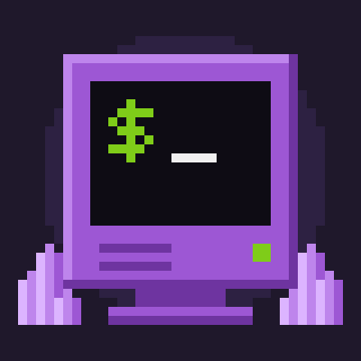
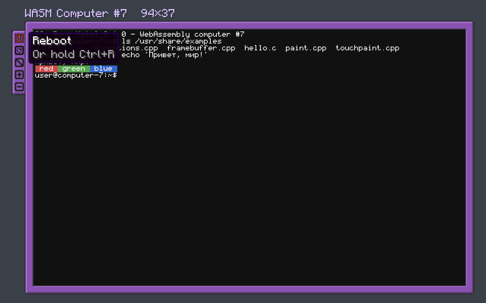
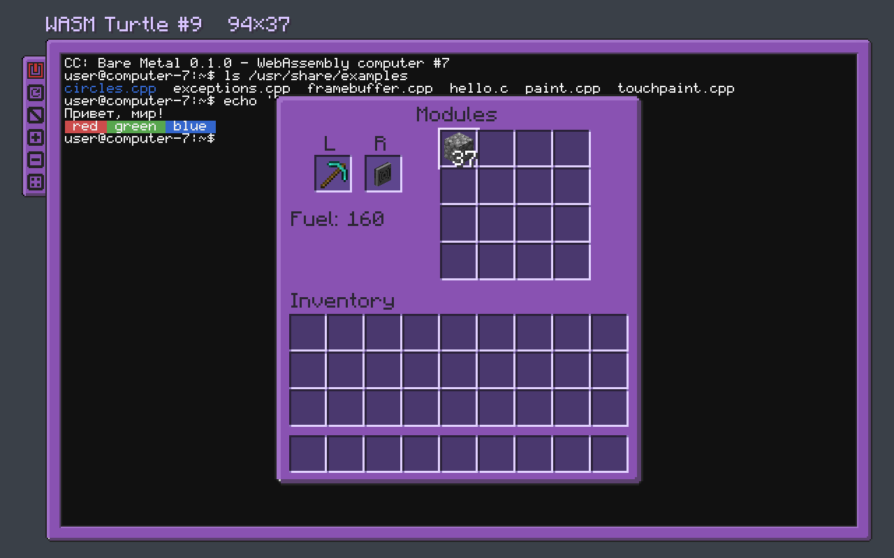

# CC: Bare Metal

[English](README.md) | **Русский**

*WebAssembly computers for CC: Tweaked: a Unix-like system, an in-game C/C++ compiler and Linux-style devices.*

Аддон для [CC: Tweaked](https://tweaked.cc) (Minecraft 1.21.1, NeoForge). Добавляет новый уровень компьютеров:
вместо Lua они выполняют программы на **WebAssembly**. Внутри — Unix-подобная система с оболочкой, утилитами и
настоящим **компилятором C/C++ прямо в игре** (с потоками и SDL2), графика до 1280×800 с цветом до 32 бит,
устройства в стиле Linux (`/dev/fb0`, `/dev/input`, `/dev/dsp`, `/dev/periph`) и доступ ко всей периферии
CC: Tweaked и его аддонов. Есть WASM-черепашка и карманный
компьютер, а обычные компьютеры, мониторы и принтеры CC получают Unicode — без форка CC и без изменения того, что
видят программы.

Программы работают в песочнице: им доступны только файлы своего компьютера.



## Возможности

**Компьютеры**

- **WASM-компьютер** — уровень выше продвинутого: обычный компьютер CC серый, продвинутый золотой, WASM —
  аметистовый. Окно оформлено как у продвинутого компьютера CC, пиксели всегда квадратные. Программы выполняются в
  своих потоках и не тормозят сервер.
- **WASM-черепашка** — ездит, копает, строит; API черепашки CC с теми же именами и ответами, так что программы для
  черепашек CC работают как есть. Улучшения ставятся в слоты, без крафта: любые из CC и аддонов.
- **Карманный WASM-компьютер** — 4 слота модулей вместо одного скрафченного улучшения: динамик, модемы, детектор
  игрока, геосканер и любые другие карманные улучшения CC и аддонов подключаются на лету.
- **Пиксельный монитор** — показывает картинку, собирается в стены до 8×6 блоков, сенсорный (`/dev/input`).

**Система и разработка**

- Оболочка `sh`: конвейеры, перенаправления, переменные, циклы, функции, `case`, подстановка `$(...)`.
- Около 175 команд: coreutils, `sed`, `awk`, `diff`, `tar`, `grep -r`, `find -exec`, `xargs`, `sha256sum`...;
  редактор `edit` с выделением, мышью и отменой; менеджер пакетов `pkg` с сетевыми репозиториями и установкой, которая не оставляет недописанных пакетов;
  справка `man`.
- **C и C++ в игре**: clang 22 и libc++ (`c++`, `g++`, `cc`, `gcc`), исключения, вся стандартная библиотека,
  `ar`/`nm`/`objdump`. Компилятор — тоже WebAssembly и работает на любой платформе.
- **Потоки**: `-pthread` даёт потоки POSIX и `std::thread`, которые работают параллельно на ядрах сервера.
- **SDL2** встроен (`sdl2-config --cflags --libs`): игры и плееры, написанные под SDL, собираются как есть — с
  графикой на экране, клавиатурой, мышью и звуком через динамики.
- **Слой POSIX** (`termios`, `posix_spawn`, `waitpid`, `popen`, `pipe`/`dup`, `sigaction`, `mkstemp`, `statvfs`,
  `ioctl` OSS...) позволяет собирать программы для Linux без правок.
- **Пользователи и права** как в Linux: установщик при первом включении (имя, пользователь, пароль), `login`,
  `passwd`, `sudo` с `/etc/sudoers`, `su`, `useradd`, `chmod`, `chown`, `lock`.
- **Клавиатура**: печатать на компьютере прямо из мира, в руке или поставленной на стол (все клавиши перехвачены, и
  Esc тоже; выход — Shift+Esc; головой вертеть можно) — как устройство `/dev/input` с относительной мышью и события Lua.
- **Сеть** через модемы CC (беспроводные, эндер, проводные), как TCP/IP: компьютеры по имени, службы по порту;
  `nc`, `ss`, сокеты в C++. Поверх неё **`ssh`** и `scp` с шифрованием и ключами хостов.
- Файлы и папки можно перетащить в окно компьютера прямо с рабочего стола.
- CraftOS и Lua с настоящим ROM CC: `craftos`, `lua файл`.

**Графика и ввод**

- Фреймбуфер на 2/4/16/256 цветов или в полном цвете (16 и 32 бита), по сети уходят только изменения: через API,
  файл `/dev/fb0`, SDL или на пиксельные мониторы.
- Ввод как в Linux: `/dev/input/event0` (клавиатура), `event1` (мышь), `event2…` (сенсоры мониторов),
  `/dev/input/mice`. Терминал в стиле xterm: мышь, клавиши с модификаторами, буфер обмена.

**CC: Tweaked и аддоны**

- Любая периферия любого мода — без кода под каждый мод: методы, объекты в ответах, глобальные API аддонов, события.
- Периферия как файлы: `/dev/periph/<имя>/<метод>`, `/dev/fbN`, `/dev/dspN` (динамики), `/dev/lpN` (принтеры),
  `/dev/monitorN` (мониторы CC как терминал), `/sys/class/redstone`.
- **Динамики как звуковая карта**: несколько программ звучат одновременно (ядро их смешивает), любой формат и
  частота (OSS), и звук не отстаёт от картинки.
- `rednet` и `gps`, совместимые с Lua-компьютерами.
- **Интернет**: `curl`, `wget`, `pkg install URL`, `cc::http` в C++, `http` в Lua — через HTTP-API самого CC, с теми
  же настройками и правилами доступа сервера.
- **Unicode для компьютеров CC**: кириллица и другие алфавиты на компьютерах, мониторах, карманах, распечатках и в
  метках. Программы по-прежнему видят байты, как в CC.



## Что нового в 0.2.0

- Потоки (`cc -pthread`, `std::thread`) и настройка `threads_per_process`.
- SDL2 в системе со своим видеодрайвером для экрана и пиксельных мониторов.
- Полный цвет: 16 и 32 бита на пиксель — через API, `/dev/fb0` и SDL.
- Звуковой драйвер: свой поток у каждой программы, смешивание в ядре; форматы и частоты OSS; задержка у игроков CC
  больше не копится, а убитая программа замолкает сразу.
- Больше POSIX: каналы, `dup`, группы процессов, `exec*`, сигналы (`sigaction`), временные файлы, `statvfs`,
  `getrlimit` и другое; в программах, собранных в игре, работают `signal.h`, `mmap` и `getpid`.
- `pkg`: сетевые репозитории (`pkg repo add URL`, `pkg index`), проверка скачанного и установка, которая сначала
  проверяет место и заменяет файлы, только когда всё записано.
- Больше по умолчанию: 256 МБ на программу, 64 МБ диска, 16 МБ `/tmp`.

## Требования

- Minecraft 1.21.1, NeoForge 21.1.249 или новее (в пределах 21.1.x)
- CC: Tweaked 1.120.0 или новее
- Java 21

Мод нужен и на сервере, и на клиенте.

## Установка

Положите `ccbaremetal-<версия>.jar` в папку `mods` рядом с CC: Tweaked. Компилятор C/C++ уже внутри jar (около 45 МБ);
при первом запуске он распаковывается в `<папка игры>/ccbaremetal/toolchain`.

## Быстрый старт

1. Скрафтите WASM-компьютер (6 осколков аметиста, алмаз, продвинутый компьютер CC, блок редстоуна) и поставьте его.
2. Откройте его (ПКМ) и нажмите Enter или кнопку питания на боковой панели.
3. Установщик спросит имя компьютера, имя пользователя и пароль; затем войдите.
4. Попробуйте:

```sh
ls /usr/share/examples
cd /tmp && c++ /usr/share/examples/hello.cpp -o hello && ./hello
man intro
```

## Документация

Подробно — в папке [docs/ru](docs/ru/README.md):

1. [Быстрый старт и окно компьютера](docs/ru/01-quick-start.md)
2. [Блоки, крафт, мониторы, черепашка, карман, клавиатура](docs/ru/02-blocks.md)
3. [Система: файлы, оболочка, команды, пакеты, интернет, Lua](docs/ru/03-system.md)
4. [Программирование на C++](docs/ru/04-cpp.md)
5. [Графика и ввод: /dev/fb0, /dev/input, пиксельные мониторы](docs/ru/05-graphics-input.md)
6. [Периферия CC: Tweaked и аддонов, /dev/periph, rednet](docs/ru/06-peripherals.md)
7. [Unicode для компьютеров CC: Tweaked](docs/ru/07-unicode.md)
8. [Настройки](docs/ru/08-config.md)
9. [Устройство и сборка из исходников](docs/ru/09-development.md)

Внутри игры та же информация есть в справке: `man intro`, `man cc`, `man sdl`, `man baremetal`, `man gfx`, `man dev`,
`man pkg`, `man keys`, `man turtle`, `man http`, `man users`, `man ssh`, `man net`.

## Сборка из исходников

```sh
./gradlew build                 # jar в build/libs
make -C userland                # пересобрать систему (C++), нужен wasi-sdk в tools/
```

Первая сборка скачивает clang (YoWASP) и переводит его в байткод JVM: около 4 минут и 4 ГБ памяти. Подробнее —
в [docs/ru/09-development.md](docs/ru/09-development.md).

## Лицензии

Собственный код CC: Bare Metal — под [Mozilla Public License 2.0](LICENSE), как у самого CC: Tweaked. Текстуры,
перекрашенные из CC: Tweaked, остаются под его [ComputerCraft Public License](LICENSES/LicenseRef-CCPL.txt)
(разрешает некоммерческие моды).

В jar также входят эти компоненты, каждый под своей лицензией (тексты — в [LICENSES](LICENSES), подробности — в
[THIRD_PARTY.md](THIRD_PARTY.md), по файлам — в [REUSE.toml](REUSE.toml)):

| Компонент | Для чего | Лицензия |
|---|---|---|
| [Chicory](https://github.com/dylibso/chicory) | выполняет WebAssembly на JVM | Apache-2.0 |
| [LLVM](https://llvm.org): clang, lld, binutils, compiler-rt | компилятор в игре (также переведён в байткод JVM) | Apache-2.0 WITH LLVM-exception |
| [YoWASP clang](https://github.com/YoWASP/clang) | сборка LLVM под WebAssembly | ISC (упаковка), лицензия LLVM |
| [wasi-libc](https://github.com/WebAssembly/wasi-libc) (с частями musl) | библиотека C всех программ | Apache-2.0 WITH LLVM-exception OR Apache-2.0 OR MIT; musl — MIT |
| libc++, libc++abi, libunwind (LLVM, из [wasi-sdk](https://github.com/WebAssembly/wasi-sdk)) | стандартная библиотека C++ | Apache-2.0 WITH LLVM-exception |
| [SDL 2.32](https://www.libsdl.org) | медиабиблиотека для портированных программ | Zlib |

ROM CraftOS, Cobalt (Lua) и HTTP CC: Tweaked берутся из установленного CC: Tweaked и в jar не входят.

## Об использовании ИИ

При разработке использовался ИИ-ассистент Claude (Anthropic): с его помощью написана значительная часть кода и
документации. Замысел, архитектура, решения, проверка и тестирование в игре — автора.

*AI-assisted: a significant part of the code and documentation was written with the help of Claude (Anthropic);
design, decisions, review and in-game testing by the author.*

## Благодарности

- [CC: Tweaked](https://github.com/cc-tweaked/CC-Tweaked) — основа: периферия, ROM CraftOS (берётся из установленного
  CC, в jar не входит), HTTP. Текстуры блоков и окна — текстуры CC: Tweaked, перекрашенные в аметист; они остаются
  под лицензией CC: Tweaked.
- [Chicory](https://github.com/dylibso/chicory) — среда выполнения WebAssembly на JVM.
- [LLVM/clang](https://llvm.org) в сборке [YoWASP](https://yowasp.org) и
  [wasi-sdk](https://github.com/WebAssembly/wasi-sdk) (wasi-libc, libc++) — компилятор и стандартная библиотека.
- [SDL](https://www.libsdl.org) — медиабиблиотека, которой пользуются портированные программы.
- Шаблон проекта — [NeoForged MDK](https://github.com/NeoForged/MDK) (`TEMPLATE_LICENSE.txt`).
